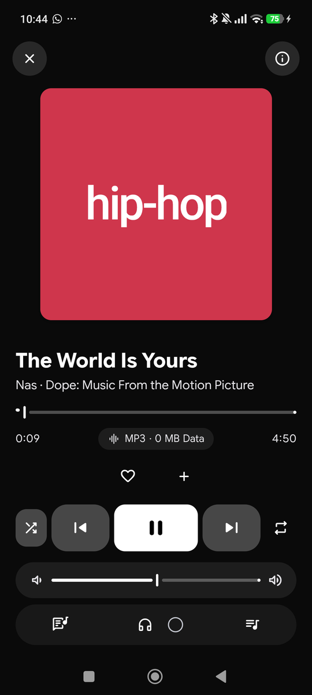
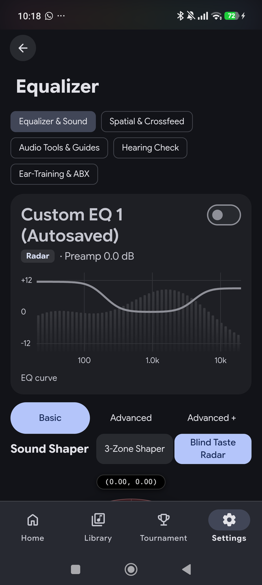
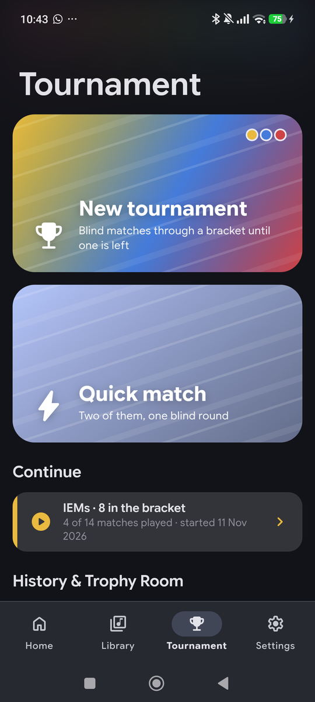
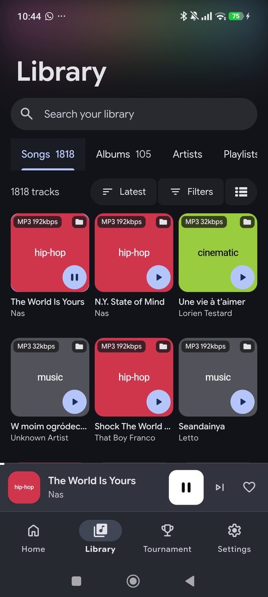

# AVSB

A music player for Windows and Android that also lets you blind-test earphones against each other.

I built it because I wanted two things in one place: a player for my own files, and a way to find out which IEM tuning I actually like without the name on the box deciding for me. "AVSB" is just "A vs B".

<p>
  
  
  
  
</p>

## What it does

**Plays your music.** Point it at a folder (PC) or let it read the phone's library. Playlists, lyrics (from the file or looked up on LRCLIB), listening stats, autoplay that learns what you skip.

**Equalizer, three ways.** Basic is three pads for bass, mids and treble. Advanced is a graphic EQ. Advanced + is a full parametric one. Switch between them and your sound comes along. You can also EQ your earphones towards a target curve, or towards another earphone's measured response.

**Tournament.** Pick a set of IEMs or headphones from the database and the app plays them off against each other, two at a time, blind, using your own songs. You vote A or B until one is left. The contenders are simulated through whatever you're wearing, from their measurements, so treat the result as a pointer and not as a replacement for hearing the real thing.

**Device database.** Thousands of IEMs, headphones and speakers with frequency response graphs, reviewer rankings and notes, and photos.

**Phone and PC together.** Pair the phone with the PC by QR code and the phone can play the PC's library from anywhere, with no account and no server of mine in between. Playlists stay in sync both ways.

Also in there: crossfeed and virtual speakers, head tracking with the camera, bit-perfect output to a USB DAC on Android, a hearing check and some ear-training tests.

## Download

Get the latest build from the [Releases page](../../releases).

- **Windows (64-bit):** unzip and run `AVSB.exe`. It isn't code-signed, so Windows SmartScreen will warn you the first time: "More info", then "Run anyway". Settings are kept in a `user-data` folder next to the exe, so the whole thing is portable.
- **Android (arm64, Android 7+):** install the APK. You'll have to allow installs from your browser or file manager.

There's no Mac, Linux or iOS build.

## Building it yourself

You need a recent Node (I use 24). For the APK you also need the Android SDK and a Java 21 JDK.

```sh
cd app
npm install
npm run dev        # the app in a browser, with hot reload
npm test           # unit tests
npm run dist       # Windows app -> app/release/shell/win-unpacked/AVSB.exe
npm run android    # debug APK   -> app/release/AVSB.apk
```

The Windows build expects `tools/ffmpeg/bin/ffmpeg.exe` at the repo root (used for low-data streaming to the phone). Any recent FFmpeg build works.

`app/` is one React + TypeScript app used by both platforms. `app/electron/` is the Windows host and `app/android/` is the Capacitor project with the native Android parts. `scripts/` holds the Python and Node scripts that build the device database.

## Credits

This app leans on a lot of other people's work:

- Rankings and review notes: Jay Audio's ranking list and videos, Fernanda Gunsan, Crinacle and the other reviewers named on each device page.
- Measurements: the squig.link databases of the reviewers named beside each graph; speaker data from spinorama.org.
- Product photos: the shops and makers named under each photo, with a link back to the page.
- Virtual speakers: HUTUBS HRTF database, TU Berlin (CC BY 4.0).
- Lyrics and song details: LRCLIB, MusicBrainz, Cover Art Archive, Deezer, iTunes Search.
- Sound effects from Pixabay creators and transition videos from Vecteezy; see `app/public/sfx/LICENSES.md` and `app/public/fx/LICENSES.md`.
- The layout follows Mornye, an open-source music player. No code was taken from it.
- Built with Electron, Capacitor, React, iroh, FFmpeg, MediaPipe and kuromoji.

If something of yours is in here and you'd rather it wasn't, open an issue and I'll take it out.

## Licence

The code is under the [GNU GPL 3.0](LICENSE). The review text, measurements, photos, sounds and videos belong to the people credited above and are not covered by that licence.
